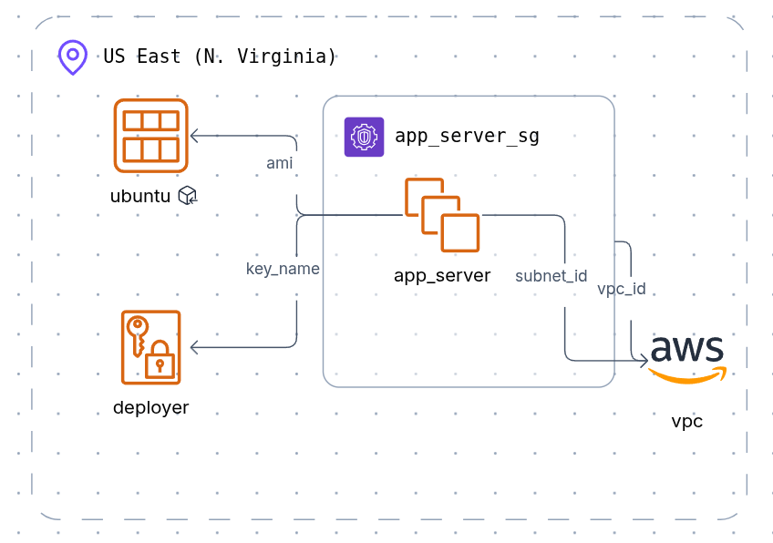

# AWS EC2 SSH



## About

Spin up an EC2 instance (ubuntu amd64) with a public ssh key within a VPC and security group that allows an ssh connection over the public internet.

## Instructions
- Pre-req: AWS CLI installed, AWS credentials added, ssh keys created for just this instance, and terraform installed
- Create a terraform.tfvars pointing to the path of the public key
  ```
  public_key_path = "~/.ssh/example-key.pub"
  ```
- `terraform init`
- `terraform apply`
- Test it out:
  - `export PRIV_KEY_DEMO_PATH="~/.ssh/example-key"`
  - `ssh -i $PRIV_KEY_DEMO_PATH ubuntu@$(terraform output -raw instance_public_ip)`
  - Should be able to connect to the EC2 instance over SSH

## Security notes

Restrict the subnet of allowable IP addresses that can attempt to SSH onto the EC2 instance,

## Credit

Diagram generated with terraform files with [Brainboard](https://app.brainboard.co/).
Inspired by aws-infra example written by Hashicorp.
